# 調剤薬局向け 保険請求売掛金管理システム（ポートフォリオ）

調剤薬局の保険請求（レセプト）を「発生 → 請求 → 入金予定 → 振込」の 4 段階で追跡し、
月次の売掛金帳票と半期ごとの誤差追求レポートを自動作成する Django 製の業務 Web アプリケーションです。

このリポジトリは**画面写真と設計概要だけ**を公開するポートフォリオです。
本体は実際の薬局業務で使用している社内システムのため、ソースコードは非公開にしています
（閲覧を希望される場合は GitHub のプロフィールからご連絡ください）。
一方で、同じ業務で使っている単体のユーティリティ 2 本は [`code-samples/`](code-samples/) にソースを置いています。

> 掲載している画面はすべて**架空のテストデータ**（薬局コード 1234567「テスト薬局」、
> 2023 年度上期の 14 パターンのシナリオ）で動かしたものです。患者名はシステムの「個人情報をマスク」機能で伏せています。

---

## 解決した課題

調剤薬局では、毎月の請求額と実際の振込額が一致しないことが珍しくありません。
原因は査定（減点）・返戻・月遅れ請求・支払機関の変更・公費併用など多岐にわたり、
従来は Excel 上で手作業で突き合わせており、半期の決算で「不明金」が残ることが課題でした。

このシステムは、審査支払機関からダウンロードできる CSV（請求確定状況・振込額明細・返戻内訳書・増減点連絡書）を取り込み、
レセプト 1 件ごとに状態を追跡することで、差額の内訳を**理由ごとに自動で分解**します。

```
 発生額            請求額             入金予定額            振込額
（レセコン日計）   （請求確定状況票）  （振込額明細の決定額）  （当座口振込通知書）
     │                │                   │                    │
     └── 未請求・保留 ─┘── 査定・返戻 ──────┘── 過誤調整・相殺 ──┘
```

---

## 画面

### ログイン

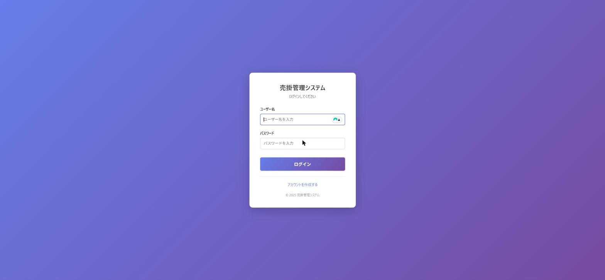

### 帳票A: 入金額算出と検証（月次）

取り込んだ CSV から請求確定額・入金額を支払機関別に自動集計し、レセコンの集計表と突き合わせます。
黄色の欄は自動計算値、差額が出た場合は理由（前月分修正・当月分修正など）を入力して不明金を追い込みます。

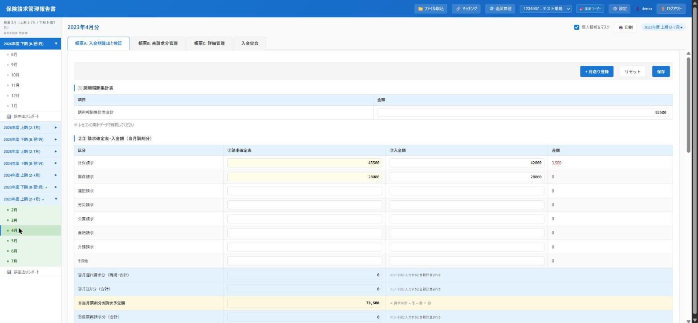
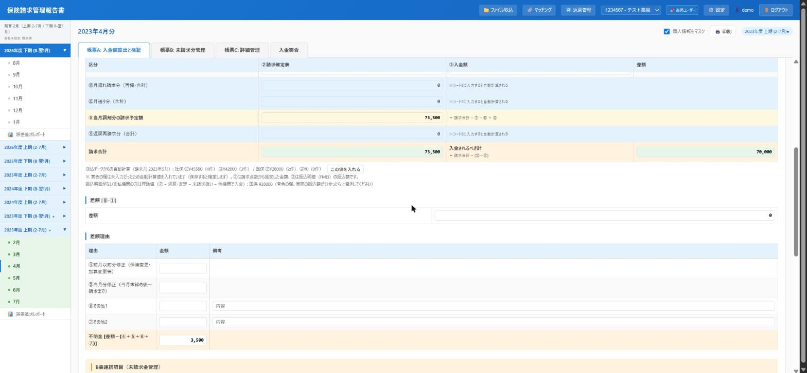
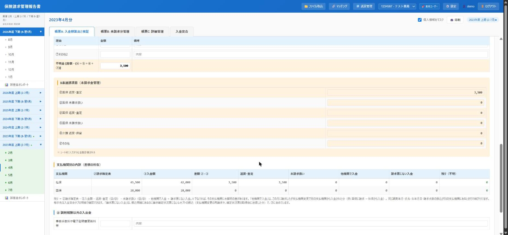

### 帳票B: 未請求分管理

返戻の再請求、月遅れ請求、月送り、保留などの「今月請求しなかった分」を個別に管理します。
帳票A の連携項目に自動で反映されます。


### 帳票C: レセプト詳細管理

レセプト単位で状態（請求済・振込完了・再請求など）とデータソース（どの CSV から来たか）を確認できます。

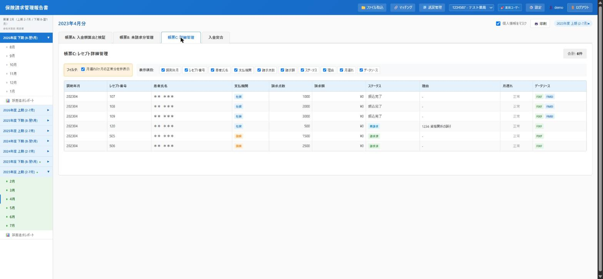

### 入金突合

請求月ごとに「請求額（推定） − 受取額 ＝ 査定 ＋ 返戻 ＋ 未入金 ＋ 他機関で入金 − 請求票にない入金」が成り立つことを検証し、
不明金が残った場合は金額から該当レセプトを探索します。

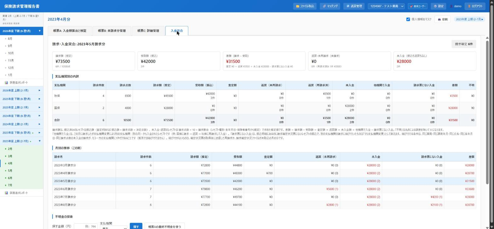

### 誤差追求レポート（半期）

決算期（上期・下期）ごとに、発生額・未請求・返戻・再請求・入金誤差を既定の様式に展開します。
下部では請求月ごとの「発生 → 請求 → 入金予定 → 振込」の推移と差額の内訳を表示します。

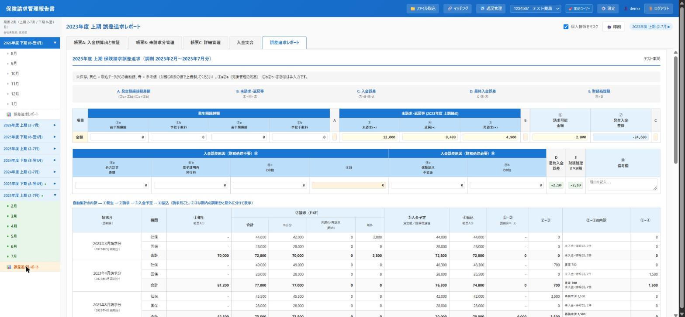
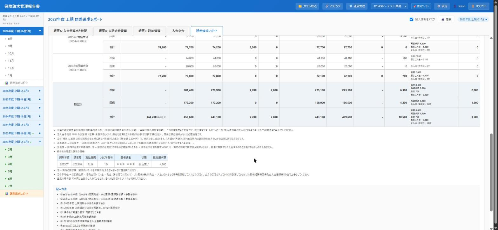

### ファイル取込

フォルダや ZIP をまとめてドロップすると、ファイル名から帳票種別・支払機関・請求年月を判定して取り込みます。
重複ファイルは自動でスキップします。

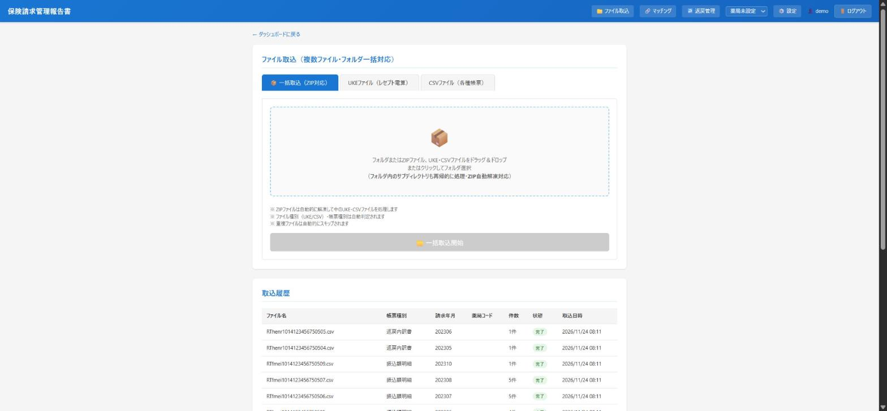

### 再請求マッチング・返戻管理

返戻されたレセプトと、その後の再請求（月遅れ請求）を自動で紐づけます。自動で判断できないものは確認待ちとして残します。

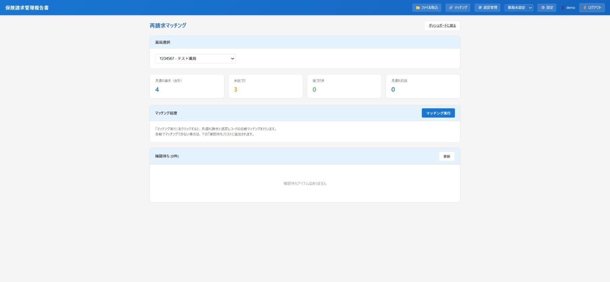
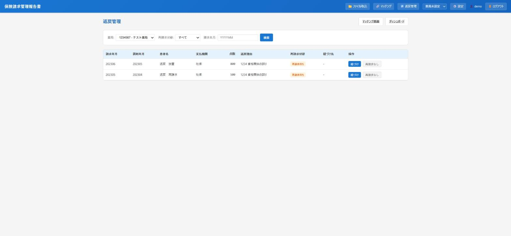

---

## 技術スタックと規模

| 項目 | 内容 |
|---|---|
| 言語・フレームワーク | Python 3.11 / Django 4.2 |
| データベース | SQLite（店舗単体運用） |
| 本番起動 | waitress + whitenoise（Django 開発サーバーは使わない） |
| 配布形態 | WinPython ポータブル版を ZIP で配布、バッチファイルで起動（店舗 PC に Python 不要） |
| モデル数 | 26（レセプト・売掛金・取込ファイル・各 CSV レコード・帳票・監査ログなど） |
| Python コード | 約 16,500 行（マイグレーション除く） |
| テスト | 69 件（単体テスト ＋ 半期分 14 パターンの通しシナリオテスト） |
| 入力フォーマット | 審査支払機関の CSV（FIXF / FMEI / HENR / ZOGN）、レセプト電算 UKE |

---

## 設計上の工夫

- **4 段階の金額を別々に持つ**
  発生額・請求額・入金予定額・振込額を 1 つの数字に丸めず、どの段階でいくらズレたかを後から説明できるようにしました。
- **通しシナリオテスト**
  正常・査定・返戻→再請求・返戻放置・月遅れ・締め後・期外・支払機関変更・保留・全額査定・過誤調整など
  14 パターンの半期データをテスト内で生成し、誤差追求レポートの各項目に正しく現れることを検証しています。
  画面写真のデータもこのシナリオをそのまま投入したものです。
- **会社ごとの決算期**
  期首の月を会社単位で設定でき、上期・下期の区切りが会社によって違う場合にも対応します。
- **個人情報のマスク表示**
  画面上の患者名をワンクリックで伏せられるため、画面共有や印刷時に個人情報が漏れにくくしています。
- **店舗で動かせる配布形態**
  クラウドを使えない店舗環境を前提に、ポータブル Python と waitress で単一 PC 上に閉じて動くようにしました。

---

## コードサンプル

本体のコードは非公開ですが、同じ業務で使っている小さなユーティリティを 2 本、そのまま置いています。
どちらも依存ライブラリなしで動きます（`python ファイル名.py` でサンプルが走ります）。

| ファイル | 内容 |
|---|---|
| [`code-samples/rt_filename_regex.py`](code-samples/rt_filename_regex.py) | オンライン請求の確定状況ファイル名（社保・国保・労災）を名前付きグループの正規表現で検証・分解する |
| [`code-samples/drug_name_regex.py`](code-samples/drug_name_regex.py) | 医薬品名を名前・剤形・規格・単位・屋号・塩などの部品に分解するパーサー。1 本の巨大な正規表現にせず、外側から順にはがす構成 |

```python
from drug_name_regex import Drug

d = Drug("バルプロ酸ナトリウムSR錠200mg「アメル」")
d.name, d.group_name, d.base_name, d.modifier, d.dosage_form, d.strength, d.unit, d.maker
# ('バルプロ酸ナトリウム', 'バルプロ酸Na', 'バルプロ酸', 'SR', '錠', '200', 'mg', 'アメル')
```

---

## 使用データについて

- 画面写真の数値・患者名・医療機関名はすべてテスト用に生成した架空のものです。
- 実在の薬局コード・保険者番号・患者情報は含まれていません。
