# 調剤薬局向け 保険請求売掛金管理システム（ポートフォリオ）

調剤薬局の保険請求（レセプト）を「発生 → 請求 → 入金予定 → 振込」の 4 段階で追跡し、
月次の売掛金帳票と半期ごとの誤差追求レポートを自動作成する Django 製の業務 Web アプリケーションです。

このリポジトリは**画面写真と設計概要だけ**を公開するポートフォリオです。
本体は実際の薬局業務で使用している社内システムのため、ソースコードは非公開にしています
（閲覧を希望される場合は GitHub のプロフィールからご連絡ください）。
一方で、同じ業務で使っている単体のユーティリティ 3 本は [`code-samples/`](code-samples/) にソースを置いています。

> 掲載している画面はすべて**架空のテストデータ**（薬局コード 1234567「テスト薬局」、
> 2023 年度上期の 14 パターンのシナリオ）で動かしたものです。患者名はシステムの「個人情報をマスク」機能で伏せています。

---

## 解決した課題

調剤薬局では、毎月の請求額と実際の振込額が一致しないことが珍しくありません。
原因は査定（減点）・返戻・月遅れ請求・支払機関の変更・公費併用など多岐にわたり、
従来は Excel 上で手作業で突き合わせており、半期の決算で「不明金」が残ることが課題でした。

このシステムは、審査支払機関からダウンロードできるファイル（請求確定状況・振込額明細・返戻内訳書・増減点連絡書・
返戻レセプト・当座口振込通知書など）を取り込み、
レセプト 1 件ごとに状態を追跡することで、差額の内訳を**理由ごとに自動で分解**します。

```
 発生額            請求額             入金予定額            振込額
（レセコン日計）   （請求確定状況票）  （振込額明細の決定額）  （当座口振込通知書）
     │                │                   │                    │
     └── 未請求・保留 ─┘── 査定・返戻 ──────┘── 過誤調整・相殺 ──┘
```

---

## 現在の実装状況（2026-11-26）

公式の仕様書と照らし合わせて実装を見直し、推測で埋めていた部分をファイルからの取込に置き換えました。

### 根拠にしている公式資料

| 資料 | 使っている範囲 |
|---|---|
| オンライン請求システム操作手順書 別添「印刷対象帳票・CSV・PDF作成対象ファイル〈薬局用〉」（令和6年5月版） | ファイル名の構成、各 CSV の項目 |
| オンライン又は光ディスク等による請求に係る記録条件仕様（調剤用）（別添1-4、令和8年8月版） | 請求ファイル（レセプト）の項目 |
| 一次請求返戻ファイル・再審査等返戻ファイル・再請求ファイルに係る記録条件仕様（調剤用）（別添D、令和8年6月版） | 返戻レセプトの項目、検索番号の決まり |

### できていること

| 分野 | 内容 |
|---|---|
| 取込 | 請求確定状況・振込額明細・返戻内訳書・増減点連絡書（CSV）、返戻レセプトと請求ファイル（UKE 形式）、当座口振込通知書・振込額合計・再審査等支払調整額通知票。フォルダや ZIP ごと取り込み、重複・労災・確認試験の出力を除く |
| 売掛金の追跡 | 売掛金 1 件 = 1 回の請求。請求確定 → 振込 / 返戻 → 再請求 → 振込 を取引履歴で追う。返戻と再請求は別の売掛金として結び付け、支払機関が変わった再請求にも対応 |
| 請求見込額 | レセプトから給付割合・一部負担金・公費の患者負担を取り出して計算（下の「設計上の工夫」参照） |
| 入金額 | 当座口振込通知書の差引振込額と振込日を取り込み、振込額明細・振込額合計・調整額通知票と検算する。推定値は入れない |
| アクセス制御 | 既定は拒否。全リクエストを 1 か所で検査し、会社単位・薬局単位の許可は管理者だけが設定できる。拒否は操作ログに残す |
| テスト | 523 件。実運用のファイルの形だけを写した架空の薬局のデータ 13 種類を、7 通りの読み込み順（まとめて・月ごと・逆順・1 ファイルずつ など）で確かめる |

### 分かっている課題

テストで見つけた食い違いは、直すまで「既知の不一致」としてテストに残しています（523 件中 19 件）。

- 振込額明細の「処理区分」（増減点なし / 増減点あり / 返戻）と「受付番号」をまだ読んでおらず、
  「決定点数 0・振込額 0 なら返戻」と推測している。このため、再請求済みの請求が入金突合で「返戻・未再請求」に数えられる、
  増減点があると取引履歴に減点が 2 重に記録される、といった食い違いが残っている（金額の合計には影響しない）。
- ファイルを新しい月から古い月の順に読むと、状態が食い違う場合がある（普段の読み込み順では起きない）。
- 返戻と再請求を結ぶ公式の鍵（検索番号）は、送信した請求ファイルを取り込まないと再請求側で分からない。
  ない場合は、レセコンが付ける請求情報から作った鍵で結び付けている（仕様で保証された方法ではない）。

### データの制約でできないこと

- **国保連の振込額**: 支払基金と違い、振込額を通知するファイルがない（紙の通知書を見て入力する）。
  所属する国保連では、近く PDF での配信が始まる予定。
- **請求確定額の実額**: 請求確定状況には金額の項目がないため、点数からの計算になる。
- **発生額**: レセコンの日計の取込は未実装（手入力）。

> 下の画面写真は 2026-11-24 時点のものです。その後、帳票A の入金額の欄（通知書から取り込んだ値は緑色で表示）などが変わっています。

---

## 画面

### ログイン


### 帳票A: 入金額算出と検証（月次）

取り込んだ CSV から請求確定額・入金額を支払機関別に自動集計し、レセコンの集計表と突き合わせます。
黄色の欄は自動計算値、差額が出た場合は理由（前月分修正・当月分修正など）を入力して不明金を追い込みます。

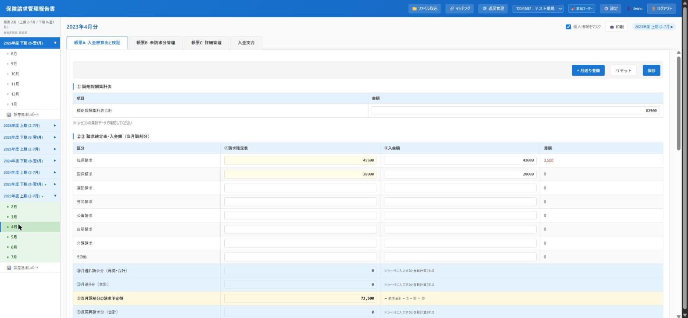
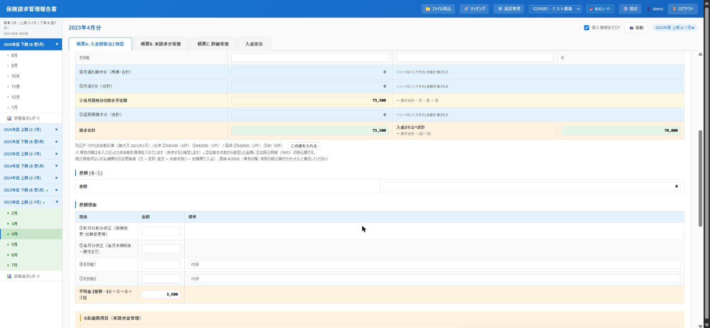
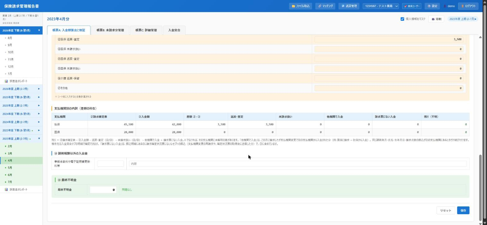

### 帳票B: 未請求分管理

返戻の再請求、月遅れ請求、月送り、保留などの「今月請求しなかった分」を個別に管理します。
帳票A の連携項目に自動で反映されます。

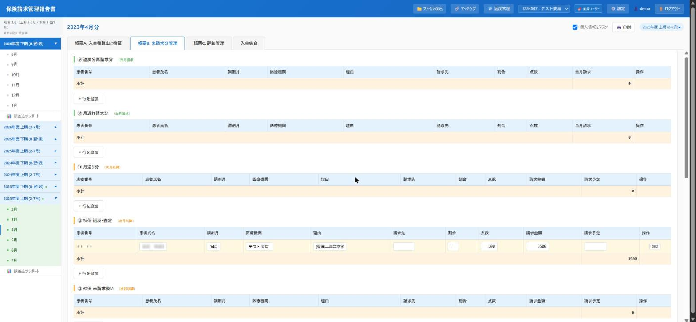

### 帳票C: レセプト詳細管理

レセプト単位で状態（請求済・振込完了・再請求など）とデータソース（どの CSV から来たか）を確認できます。

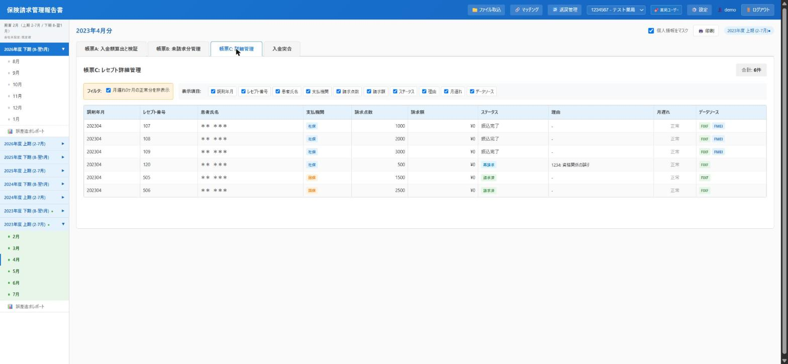

### 入金突合

請求月ごとに「請求額（推定） − 受取額 ＝ 査定 ＋ 返戻 ＋ 未入金 ＋ 他機関で入金 − 請求票にない入金」が成り立つことを検証し、
不明金が残った場合は金額から該当レセプトを探索します。


### 誤差追求レポート（半期）

決算期（上期・下期）ごとに、発生額・未請求・返戻・再請求・入金誤差を既定の様式に展開します。
下部では請求月ごとの「発生 → 請求 → 入金予定 → 振込」の推移と差額の内訳を表示します。

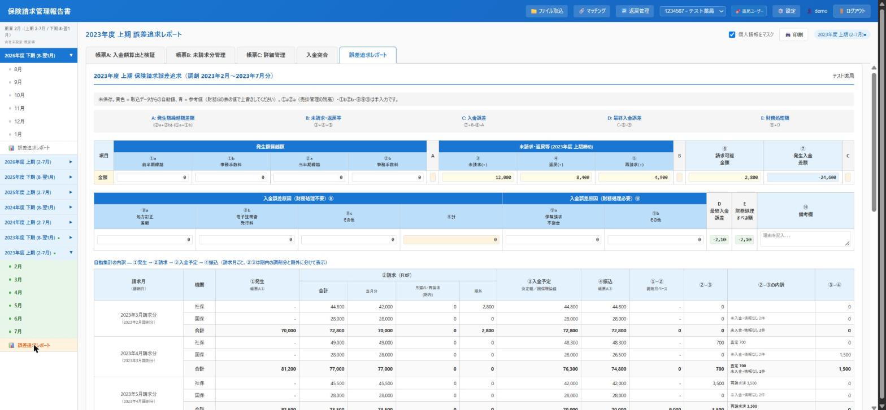
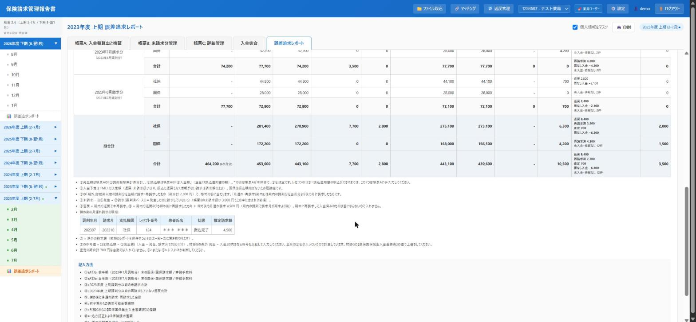

### ファイル取込

フォルダや ZIP をまとめてドロップすると、ファイル名から帳票種別・支払機関・請求年月を判定して取り込みます。
重複ファイルは自動でスキップします。

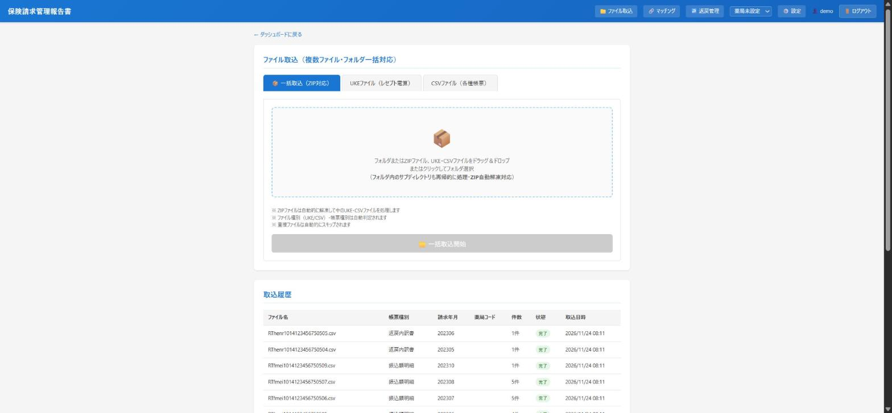

### 再請求マッチング・返戻管理

返戻されたレセプトと、その後の再請求（月遅れ請求）を自動で紐づけます。自動で判断できないものは確認待ちとして残します。

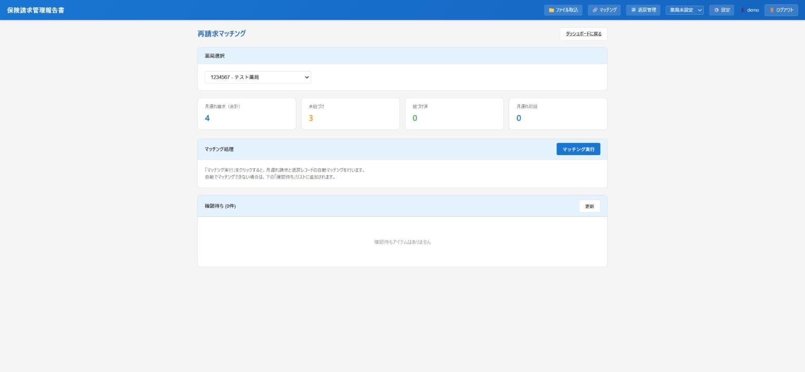
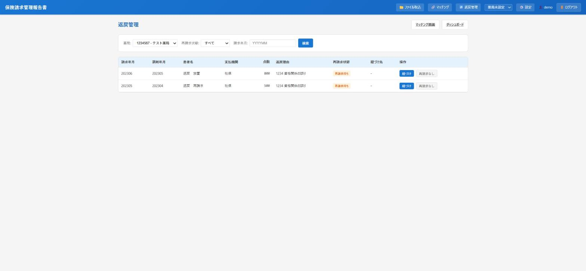

### 管理画面

会社ごとの期首の月と薬局の所属会社を設定する画面（管理者ロールのみ）と、Django 管理サイトです。
管理サイトでは取り込んだ CSV レコード・売掛金・帳票・操作ログをそのまま確認でき、売掛金一覧でも患者名はマスクされます。

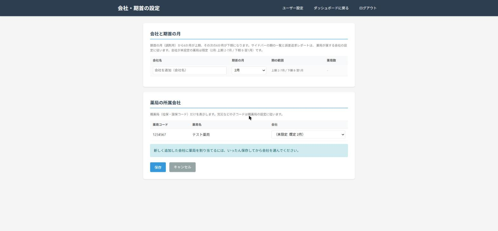
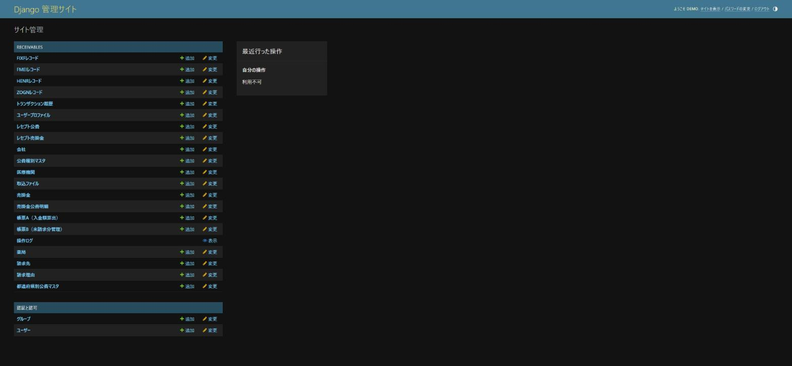
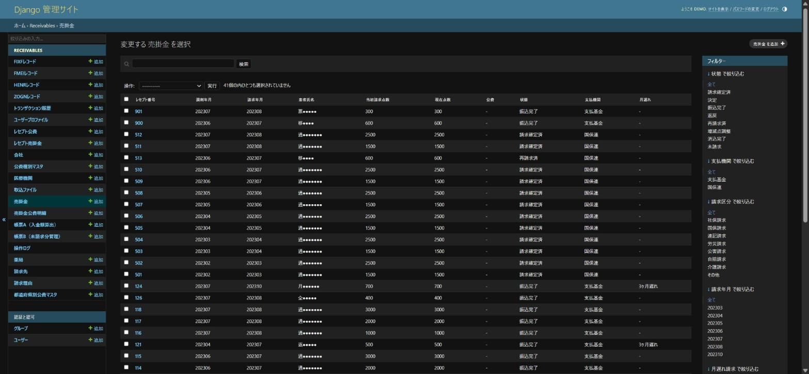
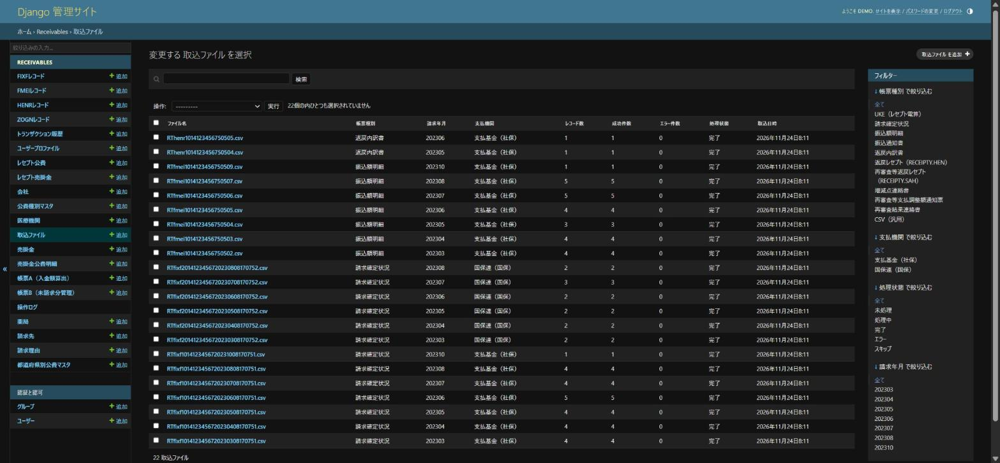
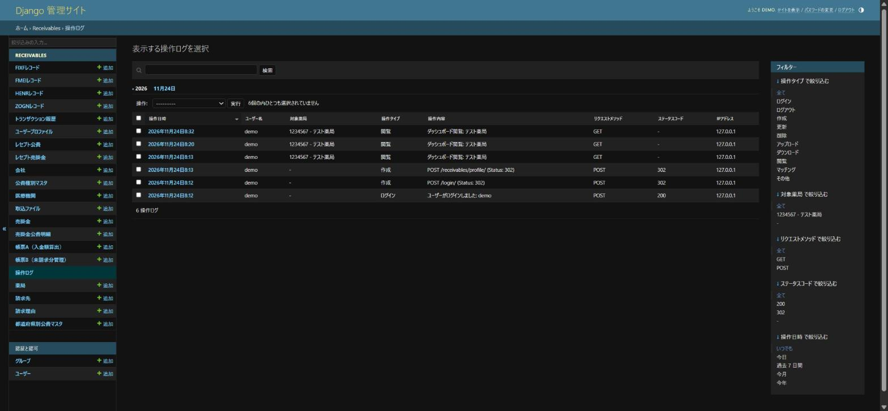

---

## 技術スタックと規模

| 項目 | 内容 |
|---|---|
| 言語・フレームワーク | Python 3.11 / Django 4.2 |
| データベース | SQLite（店舗単体運用） |
| 本番起動 | waitress + whitenoise（Django 開発サーバーは使わない） |
| 配布形態 | WinPython ポータブル版を ZIP で配布、バッチファイルで起動（店舗 PC に Python 不要） |
| モデル数 | 28（レセプト・売掛金・取込ファイル・各 CSV レコード・振込の通知・帳票・監査ログなど） |
| Python コード | 約 22,000 行（マイグレーション除く） |
| テスト | 523 件（単体テスト ＋ 半期分 14 パターンの通しシナリオ ＋ 架空データ 13 種類 × 読み込み順 7 通り ＋ アクセス制御） |
| 入力フォーマット | 審査支払機関の CSV（FIXF / FMEI / HENR / ZOGN / TGFT / FGGK / SAST）、調剤レセプト UKE（請求ファイル・返戻ファイル） |

---

## 設計上の工夫

- **4 段階の金額を別々に持つ**
  発生額・請求額・入金予定額・振込額を 1 つの数字に丸めず、どの段階でいくらズレたかを後から説明できるようにしました。
- **通しシナリオテスト**
  正常・査定・返戻→再請求・返戻放置・月遅れ・締め後・期外・支払機関変更・保留・全額査定・過誤調整など
  14 パターンの半期データをテスト内で生成し、誤差追求レポートの各項目に正しく現れることを検証しています。
  画面写真のデータもこのシナリオをそのまま投入したものです。
- **公式の仕様書と実データの両方で確かめる**
  項目の位置は仕様書に合わせ、仕様書に書かれていない関係（どのファイルの合計がどれと一致するか）は実運用のデータで検算しました。
  たとえば、当座口振込通知書の算定額は振込額明細の合計と全月で一致し、実際の振込額との差は過去の月の分の再審査等調整額でした。
- **請求見込額を 1 つの式にまとめる**
  「合計 ＝ 点数 × 10 − 患者が最後に負担する額」（公費があれば最後の公費の患者負担額）。
  支払済みレセプトの実額の 99.5% がこの式どおりでした。後期高齢者の 2 割負担は、レセプトの特記事項で判定します。
- **推定値を入力欄に入れない**
  振込額は当座口振込通知書から取り込みます。ファイルがない支払機関の欄は空欄のままにし、参考値は文中に示すだけにしました。
  自動で入れた値は色を分けて、どこから来た値かが分かるようにしています。
- **既定は拒否のアクセス制御**
  複数の会社・店舗のデータを 1 つのシステムで扱う前提で、許可した薬局以外のデータは見えないようにしました。
  画面ごとではなく入口の 1 か所で検査し、検査を外すとテストのほぼすべてが失敗することを確かめています。
- **実データを使わないテストデータ**
  実運用のファイルから点数・種別・月のずれといった「形」だけを写し、氏名・番号・医療機関名はすべて作り物に置き換えます。
  実在の値が 1 つでも混ざると、データを書き出さずに止まる検査を入れています。
- **会社ごとの決算期**
  期首の月を会社単位で設定でき、上期・下期の区切りが会社によって違う場合にも対応します。
- **個人情報のマスク表示**
  画面上の患者名をワンクリックで伏せられるため、画面共有や印刷時に個人情報が漏れにくくしています。
- **店舗で動かせる配布形態**
  クラウドを使えない店舗環境を前提に、ポータブル Python と waitress で単一 PC 上に閉じて動くようにしました。

---

## コードサンプル

本体のコードは非公開ですが、同じ業務で使っている小さなユーティリティを 3 本、そのまま置いています。
いずれも標準ライブラリだけで動きます（`code-samples/` で `python ファイル名.py` を実行するとサンプルが走ります）。

| ファイル | 内容 |
|---|---|
| [`code-samples/rt_filename_regex.py`](code-samples/rt_filename_regex.py) | オンライン請求の確定状況ファイル名（社保・国保・労災）を名前付きグループの正規表現で検証・分解する。全角・空白・拡張子の大文字をそろえる `normalize()` 付き |
| [`code-samples/rt_filename_extract.py`](code-samples/rt_filename_extract.py) | RT 系ファイル名から帳票種別・支払機関・医療機関コード・ファイル名の月を取り出す。その月が何の月か（請求を送った月か、支払機関が帳票を出した月か）を種類ごとに分け、請求月・診療月は別の値として返す。桁数で書き方が変わる日付（西暦 14 桁・和暦 5 桁など）を読み分ける |
| [`code-samples/drug_name_regex.py`](code-samples/drug_name_regex.py) | 医薬品名を名前・剤形・規格・単位・屋号・塩などの部品に分解するパーサー。1 本の巨大な正規表現にせず、外側から順にはがす構成 |

```python
from drug_name_regex import Drug

d = Drug("バルプロ酸ナトリウムSR錠200mg「アメル」")
d.name, d.group_name, d.base_name, d.modifier, d.dosage_form, d.strength, d.unit, d.maker
# ('バルプロ酸ナトリウム', 'バルプロ酸Na', 'バルプロ酸', 'SR', '錠', '200', 'mg', 'アメル')
```

---

## 使用データについて

- 画面写真の数値・患者名・医療機関名はすべてテスト用に生成した架空のものです。
- 本文中の一致率などの数字は、実運用のデータで検算した結果の割合です。個別のレセプトや金額は載せていません。
- 実在の薬局コード・保険者番号・患者情報は含まれていません。
